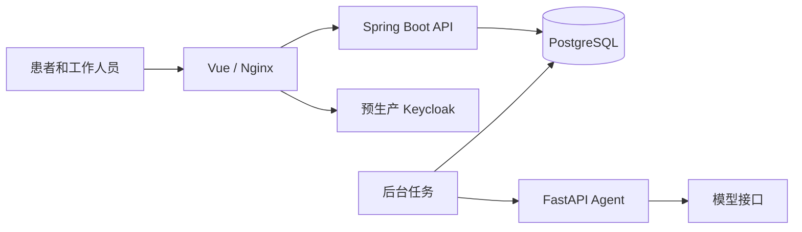

# CareContinuo 诊程桥

CareContinuo 把门诊预约、出院随访和复诊放在同一条患者记录里。患者能从首页查看下一步和站内消息。医护可以从随访草稿回到出院资料原文，核对后再派发。号源或随访安排有变动时，运营和医护可以继续跟进原预约与任务。

项目面向单院多科室，提供本机演示和合成数据预生产两种环境。

## 能做什么

| 使用者 | 业务流程 |
| --- | --- |
| 患者 | 预约、退改约、签到，查看本人的随访、检查反馈进度和站内消息。复诊改约无号时可请求协助或登记候补提醒，收到提醒后仍需自行确认预约。 |
| 医生与随访人员 | 接诊并登记合成出院资料，录入文本或导入带文本层的 PDF。使用科室模板起草、转派或送审。审核医生可对比已派发版本和新草稿，查看出处及受影响的复诊预约。 |
| 运营与管理员 | 按科室放号，预览停诊影响，分派回电并保留联络记录。查看通知补发进度、维护科室和岗位，并交接无法继续处理的随访任务。 |

随访人员可以手工起草，也可以让 Agent 从授权文本中提取明确写出的复诊安排和待跟进检查。候选条目附逐字引用。资料版本变化、出处对不上或原文存在冲突时，系统按对应状态处理，由医护核实后决定是否派发。


患者侧画面来自合成数据验收。工作人员的统一登录与人员管理见 [预生产实拍](docs/images/staff-admin-demo.png)。

## 本机体验

要使用预构建镜像，从发布页选择带 `compose.release.yaml` 的版本。该版本的发布说明提供固定镜像摘要、平台和启动命令。 [GitHub Releases](https://github.com/W205614/CareContinuo/releases)

### 从源码构建

在 Docker Engine 与 Compose 可用的环境中，从仓库源码启动演示。以下命令从新目录执行。如果已有同名 Compose 项目，先核对它的数据库卷和配置。

```sh
git clone https://github.com/W205614/CareContinuo.git
cd CareContinuo
docker compose -p carecontinuo up --build --wait
```

打开 [http://127.0.0.1:18080](http://127.0.0.1:18080)。下表账号共用本机演示密码 `demo-care-2026`。

| 账号 | 第一项操作 |
| --- | --- |
| `operations` | 开放一个门诊号源 |
| `patient-a`、`patient-b` | 分别查看首页并预约 |
| `doctor` | 接诊，或审核并派发随访 |
| `followup`、`followup-b` | 登记合成出院资料，起草或接替随访 |

首次走查可先用运营账号放号，再用患者账号预约。接着用随访人员提交草稿，由医生审核派发。患者从「我的随访」选择符合日期和科室要求的复诊号源。

### 可选真实模型

手工随访可以直接体验。要验证真实模型，从仓库根目录配置本机密钥文件的路径并叠加 `compose.live.yaml`。用 `OPENAI_MODEL` 指定该账号可用的模型，默认值见 `compose.yaml`。真实调用使用合成资料。

```powershell
$env:CARE_OPENAI_KEY_FILE = (Resolve-Path "$env:LOCALAPPDATA/CareContinuo/openai-api-key").Path
docker compose -p carecontinuo -f compose.yaml -f compose.live.yaml up --build --wait
```

### 停止与升级

`docker compose -p carecontinuo stop` 停止服务。相同项目名再次启动会沿用 `carecontinuo_pgdata`。如需改用另一个本机端口，设置 `CARE_WEB_PORT`。升级已有库前，先记录当前版本、备份数据库并核对恢复入口。回退时，把迁移前备份恢复到独立库，核对数据后再用兼容的应用版本启动。 [升级与恢复步骤](docs/预生产部署与验收.md#升级备份和恢复)

## 架构与代码入口



Spring Boot 负责对象授权、号源库存、随访版本和人工审核。通知经 PostgreSQL Outbox 保存，后台任务校验当前状态后投递站内消息。Java 在采纳 Agent 候选前再次校验资料版本和引用。本机演示在 API 进程中运行后台任务，预生产使用独立 Worker 与共享数据库会话。

| 路径 | 职责 |
| --- | --- |
| [`src/main/java`](src/main/java) · [`db/migration`](src/main/resources/db/migration) | 预约、资料、随访、通知、授权与版本迁移 |
| [`web/src`](web/src) · [`web/tests`](web/tests) | 各角色工作台与端到端回归 |
| [`agent/app`](agent/app) | 结构化提取、模型调用和原文核验 |
| [`deploy/preprod`](deploy/preprod) | 合成预生产部署、迁移验证、扫描与恢复 |

## 开发与验收

- **宿主开发**使用 Java 21、Python 3.13、Node.js 24 和独立 PostgreSQL。贡献指南包括宿主启动、单元测试与隔离 Playwright 的命令。 [贡献指南](CONTRIBUTING.md)
- **合成预生产**验证 Keycloak 与 OTP、跨科室授权、双 API 和双 Worker、数据库升级与恢复。默认 HTTPS 入口为 `127.0.0.1:18443`，Agent 使用确定性的模型替身。 [部署手册](docs/预生产部署与验收.md) · [预生产验收证据](docs/预生产部署与验收.md#验收证据)
- **产品验收**覆盖患者首页、复诊协助与候补、医护版本对比、检查结果跟进、停诊回电和通知补发。真实模型调用与合成预生产分别有验收记录。院内应用还需验证实际身份、数据接入、临床流程及运维交接。 [产品验收](docs/六项产品需求验收与复盘.md) · [首次真实模型验收](docs/首版验收记录.md) · [P2 接入说明](docs/P2外部系统接入.md)

[需求文档](CareContinuo-需求文档.md) · [开发交接](AGENTS.md) · [GitHub Issues](https://github.com/W205614/CareContinuo/issues) · [安全政策](SECURITY.md) · [项目 MIT 许可证](LICENSE) · [Maven Wrapper 许可](.mvn/wrapper/LICENSE) · [Maven Wrapper 声明](.mvn/wrapper/NOTICE)
