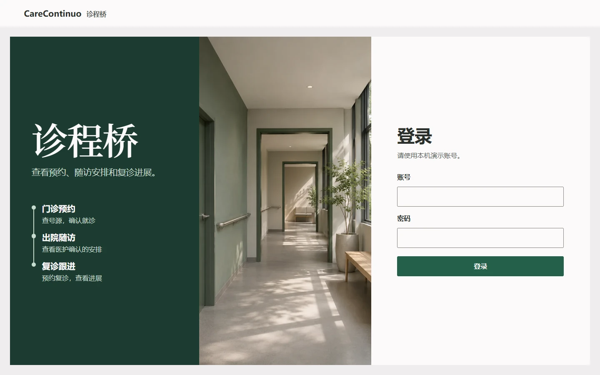
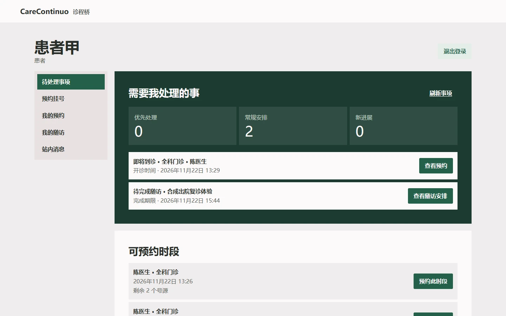
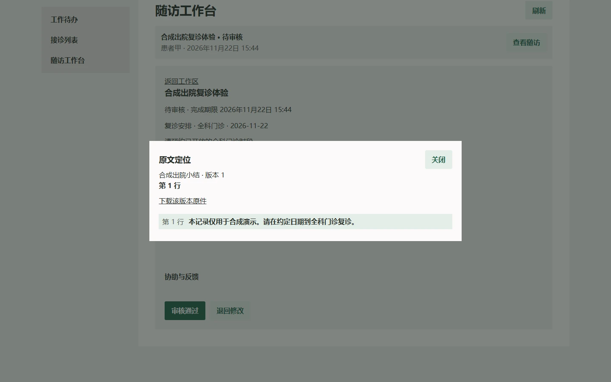
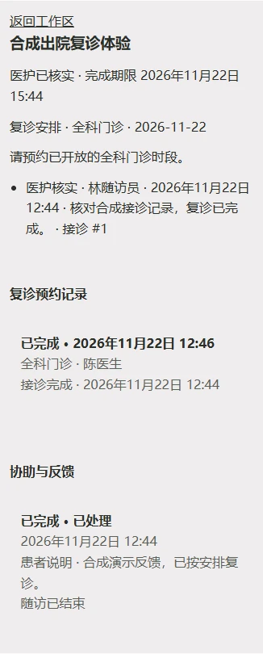
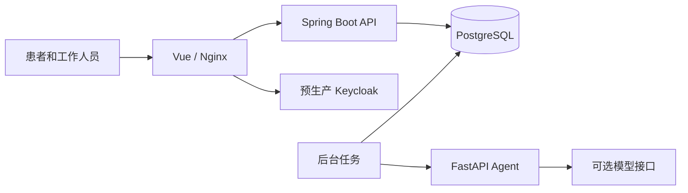

# CareContinuo 诊程桥

CareContinuo 面向单院多科室的门诊和出院随访。患者可以从同一工作台处理预约、查看医护确认的随访安排，并在复诊后收到核实结果。医护从草稿回到出院资料原文，核对后再派发。运营可以处理放号、停诊及后续联络。

**当前发布版本为 [v0.1.0](https://github.com/W205614/CareContinuo/releases/tag/v0.1.0)，镜像平台为 Linux amd64。** 项目提供本机演示和合成数据预生产。

[快速开始](#快速开始) · [完整随访体验](#完整随访体验) · [新版前端实拍](#新版前端实拍) · [架构与代码入口](#架构与代码入口) · [开发与验收](#开发与验收)

## 可以做什么

| 使用者 | 实际能力 |
| --- | --- |
| 患者 | 预约、退改约和签到，查看已派发的随访、检查进展及站内消息。符合要求的复诊时段无号时可申请协助或候补，收到提醒后自行确认预约。 |
| 医生与随访人员 | 完成模拟接诊，登记合成出院资料，手工录入或导入 UTF-8 文本及带文本层的 PDF。起草、转派和审核随访，查看原文出处、版本差异与受影响的复诊预约。 |
| 运营与管理员 | 按科室放号，预览停诊影响，分派回电、记录联络结果并查看通知补发进度。合成预生产支持维护科室、人员岗位及随访交接。 |

随访可以全程手工完成。启用真实模型后，Agent 从本次授权的资料片段提取原文明确写出的复诊安排或待跟进检查，并返回逐字引用。Java 核对资料版本和出处，医护确认后安排才对患者生效。目前使用站内通知和合成医疗数据。 [外部系统接入边界](docs/P2外部系统接入.md)

## 快速开始

准备 Git、Docker 和支持 `!reset` 与 `up --wait` 的 Docker Compose。Windows 请使用 Linux 容器模式。首次运行需要访问 GitHub、GHCR 和 Docker Hub，源码构建还需访问依赖仓库。默认入口为 `127.0.0.1:18080`。两条路线各有独立数据卷，使用相同端口时请一次运行一套。

| 路线 | 何时使用 |
| --- | --- |
| [拉取 v0.1.0 镜像](#拉取-v010-镜像) | 直接体验固定版本，免去应用镜像构建 |
| [从源码构建](#从源码构建) | 修改应用，或运行自己检出的源码 |
| [宿主开发](CONTRIBUTING.md#宿主源码开发) | 使用 Vite 热更新、Java 断点或独立调试 Agent |

### 拉取 v0.1.0 镜像

从空目录开始。下面取得同一版本的源码编排与发布覆盖文件。在 Windows PowerShell 中可用 `curl.exe` 执行下载命令。

```sh
git clone --branch v0.1.0 --depth 1 https://github.com/W205614/CareContinuo.git CareContinuo-v0.1.0
cd CareContinuo-v0.1.0
curl -fL https://github.com/W205614/CareContinuo/releases/download/v0.1.0/compose.release.yaml -o compose.release.yaml
docker compose -p carecontinuo-image -f compose.yaml -f compose.release.yaml pull
docker compose -p carecontinuo-image -f compose.yaml -f compose.release.yaml up --no-build --wait
```

启动服务包括 `web`、`api`、`agent` 和 `postgres`。覆盖文件按摘要固定三个 GHCR 应用镜像。数据库使用 Docker Hub 的 `postgres:17.11-alpine`，API 首次启动时应用 Flyway 迁移。发布镜像的源码提交为 [`0abf213`](https://github.com/W205614/CareContinuo/commit/0abf213caad5b681124cde0374c12a942731f32d)。 [镜像摘要和第三方材料](https://github.com/W205614/CareContinuo/releases/tag/v0.1.0) · [images.json](https://github.com/W205614/CareContinuo/releases/download/v0.1.0/images.json)

### 从源码构建

```sh
git clone --branch main https://github.com/W205614/CareContinuo.git
cd CareContinuo
docker compose -p carecontinuo-source up --build --wait
```

Compose 按当前检出的文件构建三个应用镜像并启动数据库。本机已有源码改动时，可在相应仓库根目录直接运行最后一行。

### 登录与检查

打开 [http://127.0.0.1:18080](http://127.0.0.1:18080)。[状态接口](http://127.0.0.1:18080/api/v1/status)返回 `{"service":"carecontinuo","status":"ready"}` 后即可登录。新演示库的下列账号共用演示密码 `demo-care-2026`，仅用于本机合成环境。

| 账号 | 界面身份 | 本次任务 |
| --- | --- | --- |
| `operations` | 排班运营 | 为陈医生开放号源 |
| `followup` | 林随访员 | 登记出院资料、起草、送审、核实 |
| `doctor` | 陈医生 | 审核、派发和模拟接诊 |
| `patient-a` | 患者甲 | 收消息、预约复诊、签到、反馈 |

端口冲突时，可在启动前设置 `CARE_WEB_PORT`（PowerShell 如 `$env:CARE_WEB_PORT = '18082'`），按选定端口访问。若启动失败，沿用启动所用的项目名和 `-f` 参数执行 `docker compose … ps` 与 `docker compose … logs api web`。 [宿主开发与排查入口](CONTRIBUTING.md)

## 完整随访体验

以下以患者甲的**合成出院复诊**为例。完成出院资料登记后即可起草，无需先走一次普通门诊。手工路线无需模型密钥。在不同浏览器会话分别登录角色，或每步切换账号。

1. **运营放号。** 在「排班与放号」选择陈医生（全科门诊），将开始时间设在约 45–60 分钟后，结束时间比开始晚 1 小时，号源数量填 2，点「开放号源」。记下该时段的北京时间日期。系统在开诊前 30 分钟关闭预约入口。
2. **随访员登记出院资料。** 在「随访工作台」展开「登记合成出院记录」，选患者甲和全科门诊，填入出院日期及唯一记录编号，例如 `DEMO-REVISIT-001`，然后登记。选中这条诊疗记录，展开「导入和更正资料」，以「合成出院小结」为标题录入「本记录仅用于合成演示。请在约定日期到全科门诊复诊。」，点「保存资料版本」。
3. **提交草稿并审核派发。** 在「新建随访草稿」选择陈医生与「复诊」，填事项标题「合成出院复诊体验」、全科门诊，以及与开放时段同日的复诊起止日期。选择晚于就诊时间的独立完成期限，填写安排内容，勾选刚录入的资料出处，保存并「提交审核」。陈医生从「工作待办」打开该任务，点击「定位原文」核对内容和日期，依次点「审核通过」和「派发随访」。
4. **患者查看通知并预约。** 等后台任务生成站内消息，患者甲从「站内消息」点「查看随访安排」。在随访详情选择符合日期和科室要求的时段，点「预约复诊」。在「复诊预约记录」确认显示「已预约」，也可在「我的预约」查到同一笔。
5. **签到并完成模拟接诊。** 到开诊前 15 分钟至开诊后 15 分钟的签到窗口，患者甲从「我的预约」签到。陈医生在「接诊列表」选择该预约，点「开始接诊」「录入接诊结果」，填写合成记录并「确认完成」。原随访可看到关联接诊完成。
6. **患者反馈，随访员核实。** 患者甲从随访详情点「填写反馈或联系医护」，选「已完成」并提交合成反馈。随访员打开原任务，点「核实结果」，在「核实依据」选择刚完成的接诊，填写处理依据并确认。患者重新打开随访，能看到「医护已核实」和关联复诊接诊记录。

### 可选真实模型

要体验 Agent 候选，从源码根目录准备一个本机密钥文件，以只读方式叠加挂载。用 `OPENAI_MODEL` 指定该账号可用的模型。启动沿用源码演示卷，实际模型请求仅使用合成资料。

```powershell
$env:CARE_OPENAI_KEY_FILE = (Resolve-Path "$env:LOCALAPPDATA/CareContinuo/openai-api-key").Path
docker compose -p carecontinuo-source -f compose.yaml -f compose.live.yaml up --build --wait
```

保存资料后，可在同一条诊疗记录中请求 Agent 候选。随访员核对引用和日期后将候选填入草稿，补齐审核医生、所需复诊条件和完成期限，沿用上述审核步骤。 [历史真实模型验收](docs/首版验收记录.md)

## 新版前端实拍

以下为 **2026-11-22 基于 `main` 提交 `40aaa9b` 的本地前端改版**实拍，使用隔离数据库和合成账号完成手工随访。`v0.1.0` 镜像保留发布时界面，采集时的远端源码尚未包含图中的本地改版。发布时的界面可查看 [随访实拍](docs/images/revisit-demo.png) 和 [合成预生产人员管理](docs/images/staff-admin-demo.png)。



<details>
<summary>查看患者首页、医护原文定位与核实结果</summary>

患者首页显示刚预约的复诊及待完成随访。



陈医生在派发前打开资料出处，定位合成出院小结的原文。



患者在手机上查看已核实的随访、复诊接诊记录及反馈。



</details>

## 架构与代码入口



Spring Boot 负责对象授权、号源库存、资料版本和人工审核。通知先由 PostgreSQL Outbox 保存，后台任务校验当前业务状态后生成站内消息。本机演示在 API 进程内运行后台任务。合成预生产独立运行 Worker，API 实例通过 PostgreSQL 共享会话。

| 路径 | 职责 |
| --- | --- |
| [Java 业务模块](src/main/java) · [数据库迁移](src/main/resources/db/migration) | 预约、诊疗资料、随访、通知、授权与 Flyway 迁移 |
| [Web](web/src) · [浏览器验收](web/tests) | 角色工作台与真实接口端到端回归 |
| [Agent](agent/app) | 模型调用、结构化提取和原文核对 |
| [预生产部署](deploy/preprod) | 隔离部署、迁移验证、扫描和恢复 |

## 开发与验收

- **本次文档走查**覆盖 `v0.1.0` 按摘要拉取启动和本地改版源码构建启动。两套隔离环境均走完登记、原文审核、站内通知、复诊预约、签到接诊及结果核实。为缩短等待，验收只在合成库内将已预约时段移入签到窗口，之后继续通过页面操作。两次均走手工路线。
- **宿主开发**使用 Java 21、Python 3.13 与 uv、Node.js 24 和独立 PostgreSQL。 [启动与测试命令](CONTRIBUTING.md)
- **历史预生产验收**覆盖 Keycloak 和 OTP、跨科室权限、双 API、双 Worker、迁移与恢复。产品验收还记录了复诊协助、候补、版本对比、停诊回电和通知补发。 [预生产部署与验收](docs/预生产部署与验收.md) · [产品验收复盘](docs/六项产品需求验收与复盘.md)

### 停止与数据

沿用启动时的项目名及编排文件。停止保留数据库卷，镜像和源码路线分别使用 `carecontinuo-image_pgdata` 与 `carecontinuo-source_pgdata`。

```sh
# 镜像路线
docker compose -p carecontinuo-image -f compose.yaml -f compose.release.yaml stop
# 源码路线
docker compose -p carecontinuo-source stop
```

若源码路线启用了真实模型，停止时也沿用 `-f compose.yaml -f compose.live.yaml`。升级前记录旧版本并备份 PostgreSQL。需要回退时，在独立数据库恢复迁移前备份，核对后再使用兼容版本。 [升级、备份和恢复](docs/预生产部署与验收.md#升级备份和恢复)

[需求文档](CareContinuo-需求文档.md) · [开发交接](AGENTS.md) · [GitHub Issues](https://github.com/W205614/CareContinuo/issues) · [安全政策](SECURITY.md) · [项目 MIT 许可证](LICENSE) · [Maven Wrapper 许可](.mvn/wrapper/LICENSE) · [Maven Wrapper 声明](.mvn/wrapper/NOTICE)
