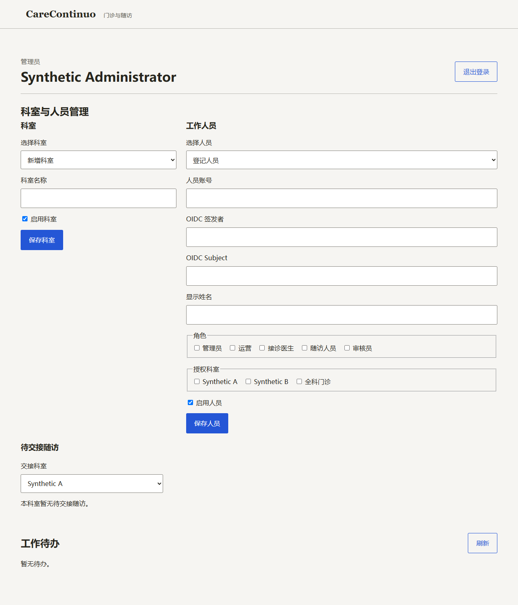
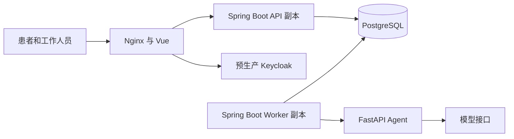

# CareContinuo

CareContinuo 为单院多科室提供门诊预约和出院随访。患者可在同一处查看预约、随访、站内消息和复诊记录。医护可以把资料出处、核准意见和后续处置关联到同一任务，运营按科室处理放号与停诊。项目提供本机演示和合成数据预生产两条启动路线。

## 核心流程

- **门诊与复诊**　运营开放号源，患者预约、退改约或签到，医生接诊并可交接复诊。复诊改约无号时，患者可在改约页直接申请协助。新号源确认后才替换原预约，库存变更和预约一起提交。
- **出院随访**　随访人员录入文本或导入文本 PDF，可手工起草，也可使用 Agent 提取附原文引用的候选。审核医生可对比已派发版和草稿，并定位变更出处及受影响预约。首页显示每个随访的最新进展，站内消息保留历史。
- **科室运营**　运营预览停诊影响、指派回电并保留联系历史。患者可从站内提醒跳到原预约查看新时间或处理结果。补发待办显示提交、成功或失败。管理员维护科室与角色，并为无法继续履职的随访人员安排接替。



上图来自合成数据预生产。另见 [患者随访及复诊历史实拍](docs/images/revisit-demo.png)。

## 启动方式

首次体验选 **本机演示**。验证工作人员统一登录、科室授权、多副本、压测和恢复选 **预生产**。两种路线都从仓库源码构建 OCI 镜像。需要单步开发时，可按 [宿主源码开发步骤](CONTRIBUTING.md#宿主源码开发) 在宿主机分别运行 Java、Python 和 Vue 工具链。

### 本机演示

在仓库根目录执行，需 Docker Desktop 或运行中的 Docker Engine 与 Compose。

```sh
docker compose -p carecontinuo up --build --wait
docker compose -p carecontinuo ps
```

打开 [本机入口](http://127.0.0.1:18080)。演示密码为 `demo-care-2026`，只适用于此本地演示。

| 账号 | 可体验的操作 |
| --- | --- |
| `operations` | 放号、处理停诊和通知待办 |
| `patient-a`、`patient-b` | 预约、退改约、签到、查看本人随访和消息 |
| `doctor` | 接诊、交接复诊安排、审核与派发随访 |
| `followup`、`followup-b` | 登记合成出院资料、起草随访、转派和核实结果 |

先用运营账号放号，再用患者账号预约。停诊后，患者从首页打开原预约处理退改约，运营从停诊清单安排回电。体验出院随访时，用随访人员登记合成资料、保存草稿并提交审核。医生派发后，患者从「我的随访」选择符合科室和日期的复诊号源。

默认支持手工随访。使用真实模型时，准备只读 API 密钥文件，填写 `CARE_OPENAI_KEY_FILE` 路径并叠加 `compose.live.yaml`。模型由 `OPENAI_MODEL` 配置，演示默认值见 Compose。真实调用只使用合成资料。

```powershell
$env:CARE_OPENAI_KEY_FILE = (Resolve-Path "$env:LOCALAPPDATA/CareContinuo/openai-api-key").Path
docker compose -f compose.yaml -f compose.live.yaml -p carecontinuo up --build --wait
```

演示数据库保存在 `carecontinuo_pgdata`。停止用 `docker compose -p carecontinuo stop`，重启沿用同一卷。升级已有库前保留迁移前备份。需要回退时，先把备份恢复到独立数据库并核对数据，再启动与备份版本匹配的应用。 [数据升级与恢复](docs/预生产部署与验收.md)

本机日常用合成数据走查患者、医护和运营三条路径。回电由值班运营按科室跟进，未接通可重新约定时间。合成场景的联系时段为工作日 09:00–17:00（北京时间）。院内使用前需确认实际分工、联系方式和数据接入条件。 [日常使用验收](docs/六项产品需求验收与复盘.md)

### 合成数据预生产

使用独立的 [预生产部署与验收步骤](docs/预生产部署与验收.md)。需 Docker Compose、Python、OpenSSL 和可访问项目依赖及容器镜像的网络。预生产默认从 [本机 HTTPS 入口](https://127.0.0.1:18443) 访问，工作人员经过 Keycloak 和 OTP 登录，患者用独立合成账号。Agent 使用确定性的模型替身，覆盖真实任务编排和人工审核链路。

预生产卷与本机演示隔离。文档提供从零启动、迁移、压测、数据库恢复和回滚步骤，并记录逐项结果。院内投用还需验收真实身份和数据接入、临床流程、基础设施容灾及运维交接。 [预生产验收结果](docs/预生产部署与验收.md#验收证据)

## 架构



Java 服务管理当前授权、预约库存、资料版本和人工审核。API 副本通过 PostgreSQL 共享会话。Worker 领取可处理的记录并在事务中写入站内消息，补发和恢复均校验当前业务状态。Python Agent 接收该任务授权的文本片段，Java 核验出处与资料版本，医护负责最后判断。演示由单个 API 进程运行这些后台任务，预生产将它们分给独立 Worker。

| 目录 | 职责 |
| --- | --- |
| `src/main/java`、`src/main/resources/db/migration` | 业务 API、授权、后台任务与 Flyway 迁移 |
| `web/src`、`web/tests`、`web/preprod-tests` | 各角色界面、演示回归和预生产端到端用例 |
| `agent/app` | Agent 提取、模型调用与返回格式 |
| `deploy/preprod` | 合成环境准备、压测、镜像扫描、升级及恢复脚本 |

## 测试与参与

常规检查、预约与随访浏览器回归见贡献指南。AC-10～14 覆盖多科室、OIDC、并发、应用副本故障和恢复。AC-15～20 覆盖患者首页、工作待办、复诊协助、反馈进度、审核对比和停诊跟进。 [贡献指南](CONTRIBUTING.md) · [预生产部署与验收](docs/预生产部署与验收.md) · [产品验收记录](docs/六项产品需求验收与复盘.md) · [历史验收记录](docs/首版验收记录.md)

- [需求文档](CareContinuo-需求文档.md) · [开发交接](AGENTS.md)
- [GitHub Issues](https://github.com/W205614/CareContinuo/issues) · [安全政策](SECURITY.md) · [MIT 许可证](LICENSE)
