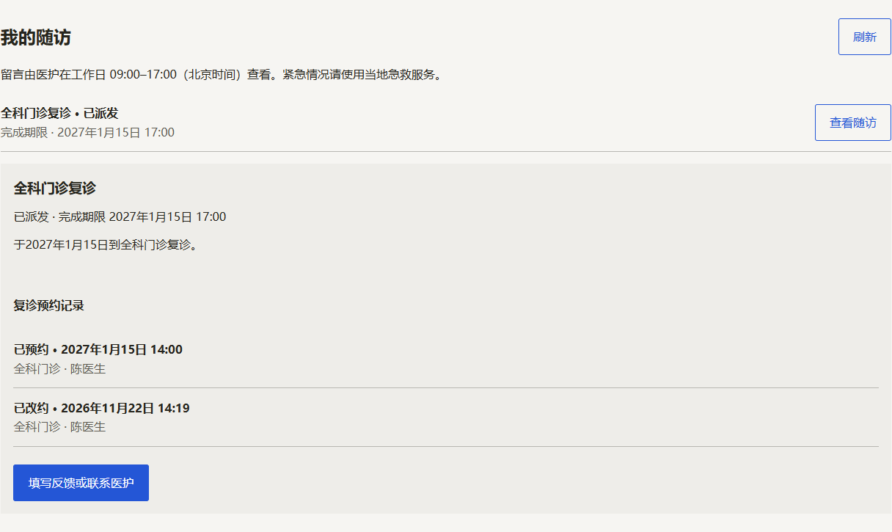
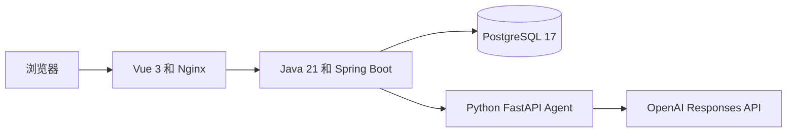

# CareContinuo

CareContinuo 是本机运行的门诊与出院随访演示。患者可以挂号、签到、查看站内消息和预约复诊。医生完成模拟接诊并审核随访，随访人员核实结果，运营人员管理号源和停诊。所有演示和测试都使用合成数据。



## 当前能力

- 门诊放号、预约、退改约、停诊、签到和模拟接诊。最后一个号源由数据库事务保护，重复提交可重放原结果。
- 导入文本或文本 PDF、维护资料版本、手工编写或由 `gpt-6.2-sol` 提取随访候选。候选附原文引用，资料冲突、更正和旧通知可追踪，派发前需要医护审核。
- 站内消息异步投递，记录已读、失败重试及人工补发。随访任务保留复诊预约历史、患者反馈、实际接诊和医护核实结果。

## 在 Docker Desktop 启动

在仓库根目录运行。Compose 从源码构建镜像，日常项目名为 `carecontinuo`。

```sh
docker compose -p carecontinuo up --build --wait
docker compose -p carecontinuo ps
```

打开 [CareContinuo 本机入口](http://127.0.0.1:18080)。演示账号密码为 `demo-care-2026`。

| 账号 | 可体验的操作 |
| --- | --- |
| `operations` | 开放号源、停诊、查看受影响的预约与通知待办 |
| `patient-a`、`patient-b` | 预约、退改约、签到、查看自己的随访和消息 |
| `doctor` | 模拟接诊、交接门诊复诊安排、审核派发随访 |
| `followup`、`followup-b` | 登记合成出院资料、生成草稿、转派和核实结果 |

默认启动支持人工随访。体验真实 GPT 时，把 API 密钥保存在本机私有文件里，再从根目录选择下面的启动命令。`CARE_OPENAI_KEY_FILE` 填写文件路径，Compose 将文件只读挂载给 Agent。模型由 `OPENAI_MODEL` 配置，默认 `gpt-6.2-sol`。

```powershell
$env:CARE_OPENAI_KEY_FILE = (Resolve-Path "$env:LOCALAPPDATA/CareContinuo/openai-api-key").Path
docker compose -f compose.yaml -f compose.live.yaml -p carecontinuo up --build --wait
```

推荐先用运营账号放号，再由随访人员登记合成出院小结、保存草稿并提交审核。复诊草稿需填写医护确认的科室、日期区间和独立的任务完成期限。医生派发后，患者从「我的随访」查看符合要求的号源。数据库数据保存在 `carecontinuo_pgdata`，普通停止和重启沿用该卷。

## 架构



Java 负责身份授权、预约事务、资料版本、人审核准与通知投递。Python 接收该任务授权的文本片段并返回候选。数据库迁移由 Flyway 管理，登录后可访问 `/api/v1/openapi`。

## 验收与参与

首版在 Docker Desktop 验证了角色流程、真实 GPT 引用、跨患者访问拦截，以及重启后的待发通知恢复。自动化测试覆盖 AC-01～09，使用独立 PostgreSQL 和模型替身。首次复诊预约和改约均校验已派发版本的日期区间和科室。扫描件可人工补录，OCR、用药查询、医保与真实医疗系统接入列入后续版本。详见[验收记录](docs/首版验收记录.md)。

- [需求文档](CareContinuo-需求文档.md)及[技术方案与开发计划](docs/技术方案与开发计划.md)
- [贡献指南和测试命令](CONTRIBUTING.md)及[开发交接](AGENTS.md)
- [安全政策](SECURITY.md)及[MIT 许可证](LICENSE)
